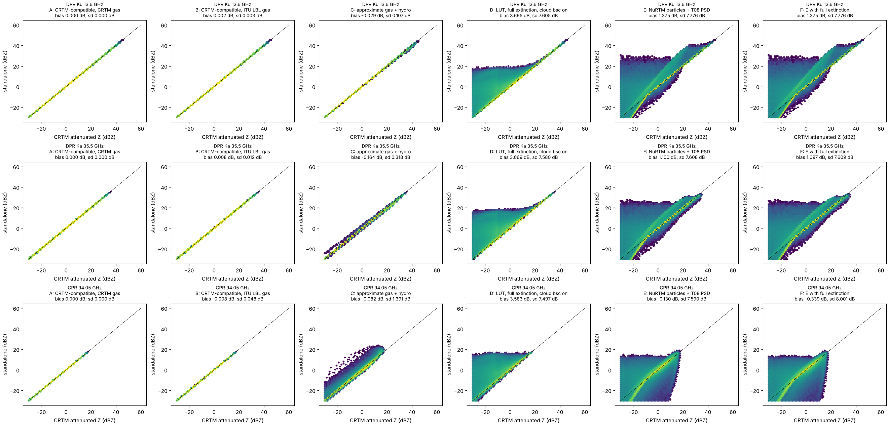
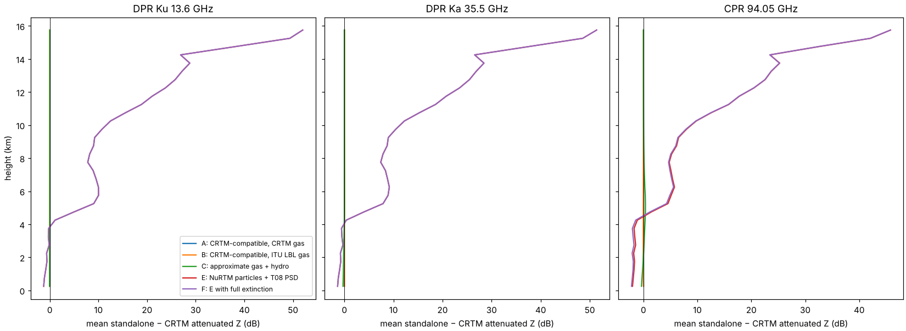
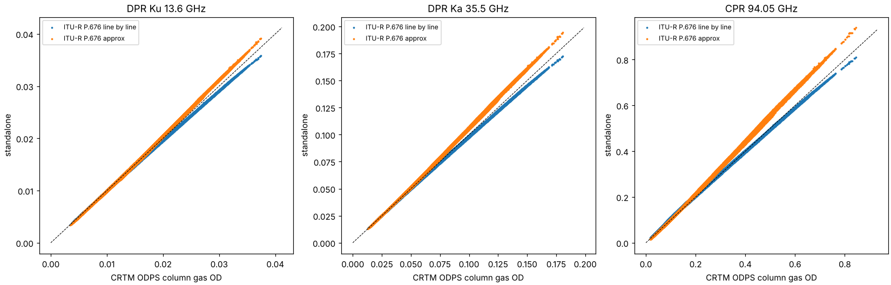
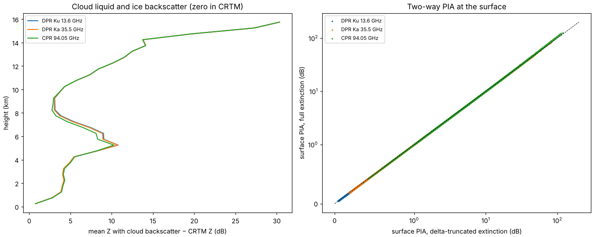

# Standalone radar operator vs CRTM

Data: `collocated_ifs-geer_atms_npp_20170907_18_00.nc`, all 60048 IFS
profiles, 136 layers, looking straight down (zenith 0°; a second run at
15° on every 4th profile gives the same statistics). Radars: GPM DPR Ku
(13.6 GHz) and Ka (35.55 GHz) with `dpr_gpm`, CloudSat CPR (94.05 GHz) with
`cpr_cloudsat`. Hydrometeors: cloud liquid, cloud ice, rain and snow from
the CloudCoeff DDA Thompson 2008 table. CRTM run with 4 streams, overcast
layers, no extra layers. Driver: `compare/compare_crtm.f90`; analysis:
`compare/analyze.py`.

## Variants

| | Gas | Hydrometeor attenuation | CRTM rules |
| --- | --- | --- | --- |
| A | CRTM ODPS optical depth passed in | full, delta-truncated | yes |
| B | ITU-R P.676 line by line | full, delta-truncated | yes |
| C | ITU-R P.676 approximation | approximate formulas | yes |
| D | ITU-R P.676 line by line | full extinction, no truncation | no (cloud backscatter on) |
| E | ITU-R P.676 line by line | NuRTM DDA single particles + Thompson (2008) PSDs, delta-truncated | n/a |
| F | ITU-R P.676 line by line | as E, full extinction | n/a |

## Reflectivity (1.34 million gates with echo per channel)

Attenuated Z, standalone minus CRTM (dB):

| Channel | A bias / max | B bias / sd / max | C bias / sd / max | D bias / sd |
| --- | --- | --- | --- | --- |
| Ku 13.6 | 2e-7 / 4e-6 | +0.002 / 0.003 / 0.015 | −0.03 / 0.11 / 2.5 | +3.7 / 7.6 |
| Ka 35.5 | 2e-7 / 4e-6 | +0.008 / 0.012 / 0.07 | −0.16 / 0.32 / 6.2 | +3.7 / 7.6 |
| W 94.05 | 4e-7 / 8e-6 | −0.008 / 0.048 / 0.31 | −0.08 / 1.39 / 32 | +3.6 / 7.5 |

Unattenuated Z agrees to 4e-6 dB in A, B and C (the rest is CRTM's single
precision |K|²). Every gate with an echo in CRTM has one in A, B and C (except 64 of 1.34 million W-band gates in C, where the approximate attenuation pushes Z below the cutoff).

## Gas absorption

Median ratio of column gas optical depth to CRTM ODPS: line by line 0.98
(Ku), 0.99 (Ka), 1.01 (W); approximation 1.02, 1.06, 1.10. The line by line
model and ODPS agree to about 2%, which moves attenuated Z by at most
0.3 dB at 94 GHz.

## What CRTM leaves out (variant D)

* **Cloud liquid and cloud ice backscatter is zero in CRTM.** These tables
  have a single-scatter albedo of 0, and CRTM's quality rule sets
  backscatter to zero when w ≤ 0. Turning it on (D) adds echo in 980 000
  more gates. For gates with only cloud liquid, the table gives a median of
  −6 dBZ against −54 dBZ from the single-particle calculation (E), so the
  cloud-liquid entries are about 50 dB too high and should not be used for
  backscatter. The cloud-ice entries give −17 dBZ, which is plausible.
* **Delta truncation of the extinction** (CRTM default) removes the forward
  peak from the attenuation. Using the full extinction raises the two-way
  PIA at the surface by about 0.5% at Ku and Ka and 1.5% at W, and by up to
  20 dB in the heaviest W-band columns (183 → 204 dB).
* CRTM's LUT phase coefficients seem to follow `(2l+1)/2·χ_l`
  (`pc1 = 1.5 g` checked). If that is so, the truncation fraction
  `f = pc(n)` is overstated by `(2n+1)/2`, and CRTM attenuation is slightly
  too low. Worth checking in CRTM.

## Approximate attenuation (variant C)

The ITU-R formulas track the full calculation at Ku (sd 0.1 dB) and are
usable at Ka (sd 0.3 dB). At 94 GHz the Rayleigh formulas for snow do not
hold, and attenuated Z differs by up to 32 dB in heavy snow and rain, so the
full calculation should be used at W band.

## Jacobians

CRTM K-matrix (seeding attenuated Z one gate at a time) against the
standalone K for the 5 profiles with the most rain and snow, 136 × 136 per
species and channel. They agree to 1e-14 of the largest value everywhere
except layers whose water content is below the lowest density in the table
(1e-6 kg m⁻³). There the table is clamped, so the forward model is flat in
water content. The standalone operator gives the derivative of that flat
function (consistent with finite differences), while CRTM keeps the slope of
the interpolating polynomial at the table edge. This affects a few layers
with very small water content (up to 16% of the rain Jacobian at W band in
those layers).

The standalone TL, AD and K also pass their own tests (TL against finite
differences to 1e-8, AD against TL to 1e-15, K against TL to 1e-16) in 24
configurations: `test/test_radar_operator.f90`.

## Single particles from NuRTM with Thompson (2008) PSDs (variants E, F)

The species are built from the NuRTM single-scattering databases
(`ssdb_nurtm/mw`, converted from the ARTS DDA database) with
`species_from_ssdb`, using the PSDs of the NuRTM validation runs:

| Species | Habit | PSD |
| --- | --- | --- |
| cloud liquid | LiquidSphere | gamma, N0 = 3e35, μ = 4, on d_veq |
| cloud ice | IceSphere | gamma, N0 = 1e10, μ = 1, on d_max |
| rain | LiquidSphere | Thompson 2008 rain (N0 = 8e6), on d_veq |
| snow | 6BulletRosette | Thompson 2008 snow, Field et al. (2005) two-mode |

As in NuRTM, the cross sections are interpolated linearly in frequency and
temperature, the PSD is evaluated on the database sizes and renormalised to
the database particle masses, and the asymmetry parameter comes from F11.
TL, AD and K pass the same tests as the other paths (6 more cases).

Median Z on gates with only one species (all 60048 profiles):

| Species | Ku: CRTM / E | Ka: CRTM / E | W: CRTM / E |
| --- | --- | --- | --- |
| rain | 2.2 / 2.3 | 2.9 / 2.9 | 2.7 / 2.6 |
| snow | −8.4 / −1.8 | −8.2 / −2.1 | −7.3 / −3.8 |
| cloud liquid | (0) / −54 | (0) / −54 | (0) / −54 |
| cloud ice | (0) / −0.1 | (0) / −0.1 | (0) / −2.0 |

* **Rain agrees with the CRTM table to 0.1 dB** at all three frequencies:
  the CRTM DDA Thompson table and the NuRTM liquid spheres with the
  Thompson rain PSD are the same physics.
* **Snow is 3 to 6 dB higher** than CRTM. CRTM's table uses the
  SectorSnowflake habit, which is not in the NuRTM database, and the
  standalone run uses the 6-bullet rosette, as the NuRTM validation runs do.
  The habit is the most likely cause.
* **Cloud liquid** gives about −54 dBZ, realistic for the small water
  contents in these gates.
* **Cloud ice** with the gamma PSD (N0 = 1e10, μ = 1) gives about 0 dBZ for a
  few mg m⁻³, which is high for cloud ice (typically −30 to −15 dBZ). That
  PSD puts the mass in particles of a few hundred micrometres. A cloud-ice
  PSD with more, smaller particles (or the number concentration from the
  model) would be more realistic.
* Full extinction (F) only changes the attenuation at W band (Zatt bias
  −0.13 dB with truncation, −0.34 dB without).
